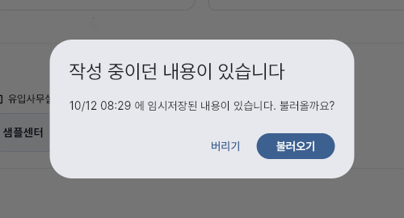
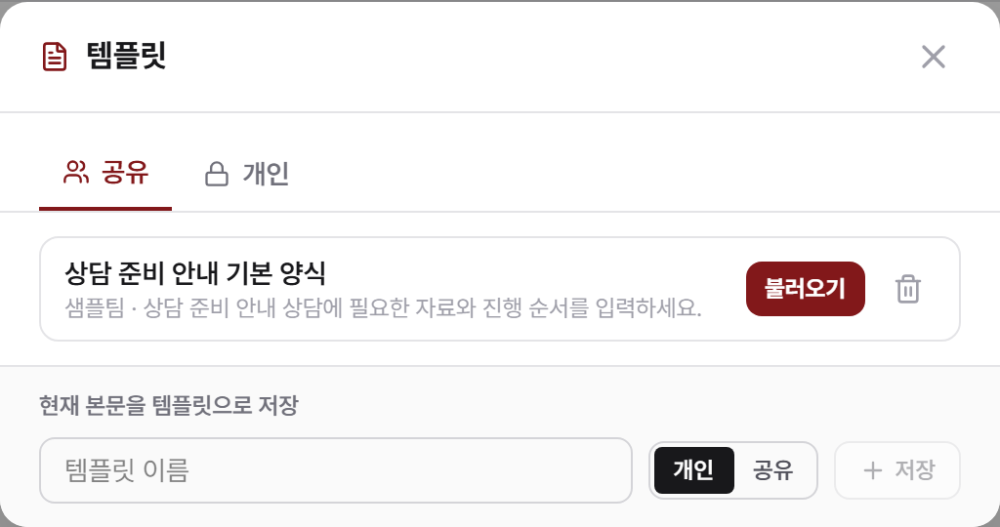
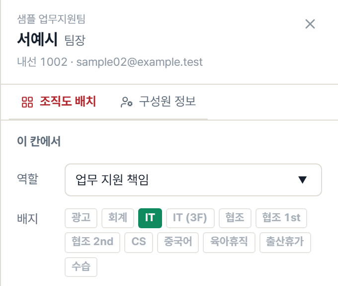

# 진솔 | 풀스택 개발자

사내 업무 시스템과 고객 접수 서비스를 개발하고 운영합니다. 구글시트 업무를 CRM으로 옮기고 레거시와 연동하는 신규 홈페이지·CMS를 구축했습니다. 화면 입력과 업무 데이터·외부 서비스 반영을 연결하며 데이터 이관·배포·장애 대응을 담당합니다.

법무법인 법승에서 CRM·홈페이지 V2·사내 포털을 단독 개발합니다. 사건관리 앱은 **2인 팀**에서 상담·문서·전자결재·정산 도메인과 공통 화면, 인프라·배포를 담당합니다. 이전에는 운영 웹서비스 유지보수와 기존 시스템 분석을 수행했습니다.

## 경력

- **법무법인 법승** | 2026.01.19 ~ 현재 | 사내 시스템 풀스택 개발·인프라 운영
- **IT 솔루션 기업 · 공간정보융합팀** | 2024.08 ~ 2025.06
  - 인턴: 2024.08 ~ 2025.02 / 사원: 2025.03 ~ 2025.06

## 핵심 기술과 담당 범위

| 영역 | 기술과 적용 |
| --- | --- |
| 프런트엔드 | React·TypeScript·Next.js, Flutter. 업무 폼, 공통 목록, 반응형 화면, 서버 상태 관리 |
| 백엔드·데이터 | NestJS·Express·FastAPI, Prisma·SQLAlchemy, PostgreSQL. 업무 API, 데이터 연동, 감사로그 |
| 배포·운영 | Cloud Run·Cloud Build·Cloud SQL·GCS·Secret Manager, Docker. 컨테이너 배포, 데이터 이관, 운영 대응 |
| 외부 연동 | Google Workspace API, NCP SENS, SQL Server 레거시 연동 |
| 보조 경험 | Vertex AI·pgvector 기반 RAG 구현·평가, ASP.NET 유지보수, Go 기존 시스템 분석 |

아래 사진은 실제 프런트엔드 소스를 격리된 로컬 환경에서 실행한 부분 캡처입니다. 고객·직원·문서·계정은 샘플 데이터로 대체했습니다. 본문은 업무 기록상의 개발 내용이며, 사진은 해당 화면과 입력·편집 동작을 보여줍니다.

<!-- page-break -->

## 사내 CRM | 상담 입력부터 일정·문자 안내까지

**기간:** 2026.01 ~ 운영 중 / 정식 오픈 2026.05  
**구성:** Flutter(PWA·Android), Express, PostgreSQL, Google Workspace API, NCP SENS  
**담당:** 화면·API·데이터 구조·이관·배포를 단독 개발

지사별 고객 유입·변호사 배정·상담 예약·문자 안내를 연결하는 CRM입니다. 기존 시트와 신규 시스템이 공존하도록 연동 구조를 만들고, Google Sheets → MySQL → PostgreSQL로 저장소를 전환했습니다.

*실제 Flutter 소스 로컬 실행·샘플 데이터. 입력 중단 뒤 초안을 다시 불러오는 대화상자입니다. 복원 버튼을 눌러 샘플 사건명·문의내용이 표시되는 것도 확인했습니다.*

### 상담 담당자가 이어서 처리하는 흐름

상담 등록 화면에서 고객·상담일시·사건 정보·담당 상담사·유입 사무실을 함께 입력합니다. 다중 상담사 선택과 종료시간 입력을 지원하고, 상담 등록·수정·삭제를 Google Calendar에 반영하도록 연결했습니다. 상담 시트와 DB를 연동해 과도기의 기존 입력 경로도 함께 처리했습니다.

문자 화면에서는 발송번호별 양식, 예약 시각, 이미지 첨부를 다룹니다. 길이는 글자 수가 아닌 실제 바이트 수로 판정하고 SMS·LMS·MMS를 구분했습니다. 예약·템플릿 발송과 MMS 이미지 변환을 구현해 입력 화면의 선택이 발송 요청과 이어지도록 구성했습니다.

### 업무가 중간에 끊기는 상황 처리

- **입력 보존:** 상담·당사자·문자 입력을 사용자별로 브라우저에 임시저장하고, 다시 열면 불러오기·버리기를 선택하도록 했습니다. 서버 저장에 성공한 뒤 초안을 지우며, 세션 만료로 로그인할 때 작업하던 화면으로 돌아오도록 처리했습니다.
- **접수 점유:** 같은 접수 건을 여러 직원이 처리할 수 있어 처리자 점유 상태를 표시하고 미조작 시 회수하는 흐름을 구현했습니다. 다른 직원에게 현재 처리 중인 건을 알려 중복 처리를 제한했습니다.
- **직원 식별:** 직원 연결 기준을 이름에서 고유 사원키로 바꾸었습니다. 이름 표기가 바뀌어도 상담 일정·계정·연락처가 같은 직원을 가리키도록 Google Calendar·Admin Directory·People API와 연결했습니다.

당사자·상담·문자 및 전화 기록 약 **9.8만 건**을 초기 적재하고 Apps Script 트리거·웹훅으로 시트·DB 동기화를 구현했습니다. 기존 입력과 신규 입력이 함께 발생하는 운영 단계도 담당했습니다.

<!-- page-break -->

## 홈페이지 V2 | 운영자가 편집·발행하는 공개 사이트와 CMS

**기간:** 2026.05 ~ 진행 중  
**구성:** Next.js App Router, NestJS, Prisma, PostgreSQL, Turborepo, Cloud Run·Cloud Build·GCS  
**담당:** 공개 사이트·운영 CMS·API·이관·배포를 단독 개발

ASP.NET·SQL Server 홈페이지를 기반으로 공개 사이트·CMS를 구축했습니다. 주 도메인 전환 후 운영 판단에 따른 롤백을 수행했으며, 현재 레거시·V2 병행 조건에서 콘텐츠·상담 운영과 동기화를 담당합니다.

*원본 CMS 템플릿 컴포넌트 로컬 실행·샘플 데이터. 공유·개인 템플릿과 본문 불러오기 구성을 보여줍니다. 서버 저장 경로는 로컬 샘플 응답으로 대체했습니다.*

### 작성한 내용과 공개 결과를 연결

콘텐츠 유형별 폼, 팀 공용·개인 템플릿, 자동 목차, 이미지·PDF 첨부를 구현했습니다. 자주 쓰는 본문 구성을 템플릿으로 저장해 불러오고, 편집기와 공개 화면의 이미지 정렬·링크 표현을 맞췄습니다. 긴 글 저장 요청이 실패해 작성 내용이 사라지던 문제는 요청 한도와 실패 처리 흐름을 함께 고쳐, 입력을 유지하고 오류 사유를 안내하도록 했습니다.

발행은 미래 예약과 과거 소급 등록을 구분했습니다. 운영자가 날짜를 지정할 때 기존 글의 작성일이 다른 날짜로 바뀌지 않도록 처리하고, 예약·공개·숨김 상태를 공개 사이트의 노출 조건과 연결했습니다. 어드민 목록은 화면 폭에 따라 카드·표로 전환하고 터치 영역과 저장 바를 정리했습니다.

### 운영 설정과 레거시 연동의 기준

- **지사별 추적 설정:** GTM 스니펫 전체를 입력받는 대신 형식을 검증한 컨테이너 ID를 저장하고 코드가 스니펫을 생성하도록 했습니다. 지역 경로를 기준으로 컨테이너를 결정하며, 화면 구조에 의존하던 전환 신호를 `dataLayer` 이벤트로 정리했습니다.
- **데이터 동기화:** SQL Server 데이터를 PostgreSQL로 이관하고, 레거시에서 신규 백엔드 HTTPS API로 변경 내용을 전달하도록 전환했습니다. 양쪽이 자체 번호를 발급하는 조건에서 원본 키·접수 고유키로 대조하고, 기존 예약 글의 공개 상태 변경도 다시 반영했습니다.
- **공개·접근 조건:** 기존 상세 주소의 301 이전과 동적 사이트맵을 구성했습니다. 상담 내용 마스킹, 접수 빈도 제한, reCAPTCHA 실패 시 차단, 어드민 Google 로그인도 적용했습니다.
- **배포 순서:** 프런트·백엔드 컨테이너와 빌드 파이프라인, 로드밸런서·인증서를 구성했습니다. 화면과 API 계약이 함께 바뀌는 변경은 배포 순서를 명시하고, 도메인 롤백 이후 상담 데이터의 양쪽 반영을 처리했습니다.

홈페이지 내부의 Vertex AI·pgvector RAG 모듈은 직원 대상 시범 운영 중입니다. 의미·글자 검색 결합, 출력 연락처 검증, 개인정보 동의·보관·파기와 정기 색인 갱신을 구성했습니다.

<!-- page-break -->

## 사내 포털 | 구성원 입사·변경·퇴직과 조직도 편집

**기간:** 2026.08 ~ 운영 중  
**구성:** Next.js, Auth.js, React Flow, GCS, Google Workspace API, Cloud Run·Firebase Hosting  
**담당:** 화면·API·인증·저장 구조·배포를 단독 개발

Google Sites의 PDF 조직도와 별도 크롬 익스텐션에 나뉘어 있던 구성원 조회·계정 관리를 포털로 모았습니다. 일반 직원은 연락처·일정·내선 통화를 이용하고, 정보실은 조직도 편집과 계정 관리를 수행합니다.

*실제 포털 인물 편집 패널을 로컬 실행해 상단만 캡처했습니다. 조직도 배치와 구성원 정보의 탭, 역할·배지를 보여줍니다. 입력은 브라우저 초안이며 외부 서비스에 저장하지 않았습니다.*

### 화면을 보며 사람과 조직을 수정

조직도에서 사람을 선택하면 역할·배지·순서를 고치는 패널과 구성원 정보 탭이 열립니다. 조직을 선택하면 대표번호와 연결 정보를 수정합니다. 배치 변경은 초안으로 모아 확인 후 저장하며, 계정·조직 정보는 저장 대상과 적용 시점을 별도로 안내했습니다. 캘린더와 사건 폴더 관련 값을 바꿀 때는 상담 일정 동기화나 사건 앱에 미치는 영향을 확인창에 표시했습니다.

| 데이터 | 원본과 저장 기준 |
| --- | --- |
| 이름·직위 | CRM 연동 정보를 사원키로 연결. 변경 직후에는 Google 저장값 반영 |
| 조직도 배치·순서·배지 | 포털의 GCS JSON 버전 파일. 초안 확인 후 저장 |
| 계정·소속·지사별 내선 | Google Admin에서 관리. 조직도 배치 저장과 구분 |

CRM이 사용하지 않는 조직도 배치는 포털에, 계정·소속은 Google Admin에 두었습니다. 사람의 기본 정보와 그림의 배치를 구분해 화면의 안내와 저장 구조를 맞췄습니다.

### 변경 권한과 후속 업무

- **입사·인사 변경:** 계정 추가·수정·정지 화면을 구현하고 고유 사원키와 임시 비밀번호를 연결했습니다. 소속·지사·직무 같은 맞춤속성은 Google 스키마 정의에 맞춰 검증했습니다.
- **퇴직 예약:** 고용상태의 퇴직 전환과 계정 정지를 구분해 예약합니다. 포털 요청 시 기한이 지난 작업을 처리하고, 실패 내역을 기록해 재시도하도록 구성했습니다.
- **권한·동시 저장:** 쓰기 요청마다 정보실 재직 여부를 판정하고 권한 원본 조회 실패 시 차단합니다. 저장 시 GCS 세대 번호가 바뀌었으면 충돌로 거절해 다른 관리자의 변경을 덮어쓰지 않도록 했습니다.
- **변경 이후 표시:** 구성원을 고친 뒤 화면 데이터를 갱신하고 수신 알림 번호표 작업의 실행을 요청합니다. 일반 직원에게는 같은 사람 칸에서 연락처·통화·구글챗·이메일 카드가 열립니다.

인증에서는 Firebase Hosting의 쿠키 처리 차이를 재현해 비공개 GCS 스냅샷 로그인 브리지를 구성했습니다. 서버 공통 값과 사용자별 일정 데이터를 나누고, 명부와 일정 영역도 분리해 불러오도록 했습니다.

<!-- page-break -->

## 사건관리 앱 | 2인 팀의 문서·전자결재 업무

**기간:** 2026.06 ~ 진행 중 / 일부 지사 베타 운영  
**구성:** React·TypeScript·Vite, TanStack Query·Table, FastAPI, SQLAlchemy, PostgreSQL, Cloud Run  
**팀·담당:** 2인 개발팀. 본인은 상담·문서대장·전자결재·정산 도메인, 공통 화면, 인프라·배포 담당

사건·상담·계약·수납 등 법률 실무를 연결하는 사내 도구입니다. 아래는 팀 안에서 본인이 담당한 화면·업무 로직과 운영 조치입니다.

*실제 프런트엔드 소스 로컬 실행·샘플 데이터. 2인 팀에서 담당한 전자결재 목록과 상태별 탭, 승인·반려 입구를 보여줍니다. 실제 결재 처리·DB 저장·Drive 상태 변경은 실행하지 않았습니다.*

### 문서 등록에서 승인·반려까지

기안·결재 요청을 분리하고 승인·반려는 앱에서 처리하는 흐름으로 구성했습니다. 결재 대기·기안함·참조함·완료 상태를 구분해 목록을 탐색하고, 문서 처리 후 남은 업무로 이어지도록 동선을 설계했습니다. 탭 상태는 URL과 연결해 화면을 다시 열거나 뒤로 돌아왔을 때도 선택을 유지하도록 했습니다.

문서 확인과 승인·반려 입력을 연결하고, 반려 사유 입력과 즉시 승인을 구분했습니다. Google Drive 라벨과 결재 상태를 연동해 앱과 외부 파일의 상태 표시를 연결했습니다.

### 다른 담당 화면과 공통 처리

- **상담료 화면:** 처리 대기 항목을 선택하면 상담 정보가 입력 폼에 반영되도록 구성했습니다. 목록·입력 영역과 상태 필터를 연결해 조회한 내용을 다시 입력하는 단계를 줄였습니다.
- **공통 목록:** DataTable에서 컬럼 폭·순서·표시를 저장하고, 정렬 상태를 페이지에서 관리했습니다. 데스크톱 표와 모바일 카드가 같은 정렬 값·비교 함수를 사용하도록 구성했습니다.
- **감사로그·변경 전파:** SQLAlchemy 세션 훅에서 변경 내역을 수집하고 업무 데이터와 감사로그를 같은 트랜잭션에 기록했습니다. PostgreSQL `LISTEN/NOTIFY`·SSE와 관련 쿼리 캐시 갱신을 연결했습니다.
- **업무 기록:** 수발신 문서·열람등사 화면과 공휴일을 고려한 기한 알림을 구현했습니다. 회계 데이터 차이는 읽기 전용으로 대조해 중복과 동기화 방향 문제를 확인했습니다.
- **배포 대응:** 의도와 다른 이미지가 배포되어 API가 HTML을 반환한 원인을 분석했습니다. Dockerfile 명시 → 이미지 빌드·배포 → 응답 본문·Content-Type 확인 절차를 정리했습니다.

<!-- page-break -->

## 레거시 홈페이지 | 유지보수 내재화와 운영 전환 대응

**기간:** 2026.01 ~ 진행 중  
**구성:** ASP.NET Core·CSHTML, JavaScript·CSS, SQL Server, Windows Server·IIS  
**담당:** 화면·백엔드 유지보수, 소스 이관, 배포·장애 분석, DNS·데이터 연동

외주 소스를 사내로 이관하고 WEB·BLL·DAL 구조와 빌드·업로드 절차를 문서화했습니다. 반응형 화면 오류, 검색용 URL과 목록 복귀 상태를 수정하고 외부 콘텐츠 업로드 API를 구현했습니다. 접속 오류는 IIS·호스팅 번들·DB 설정 등 계층별로 분석하고 FileZilla 업로드·배포 확인 절차를 정리했습니다.

DNS 전환·롤백에서는 레거시 HTTPS 응답과 인증서, DNS 반영 상태를 확인했습니다. 신규 사이트에만 남은 상담은 시간대와 번호 충돌을 처리해 레거시 DB에 반영했습니다. 양쪽 DB에 직접 연결하던 동기화는 신규 백엔드 HTTPS API로 변경 내용을 전달하도록 바꾸고, 게시물·상담·예약 글을 복구했습니다. 실패 알림 외에 일정 시간 실행 기록이 없는 경우도 감시하도록 구성했습니다.

## 이전 경력 | 웹 유지보수와 기존 시스템 분석

**IT 솔루션 기업 재직:** 2024.08 ~ 2025.06 / 일학습병행 인턴 후 사원 전환

- **공공 연구기관 CCTV 모니터링:** Node.js 웹서비스를 유지보수했습니다. FFmpeg 처리를 Windows·Ubuntu 환경별로 분기하고 Ubuntu 실행·배포 스크립트를 정리했습니다.
- **에너지 기업 기존 시스템 분석:** 신규 개발에 앞서 Go·JavaScript 시스템의 API 흐름, 인증, WebSocket 전달 구조를 분석하고 디렉터리·컴포넌트별 요청·응답 관계를 설계 근거자료로 정리했습니다. 본인의 신규 구현이 아닌 운영 코드 분석 업무입니다.
- **제조업 고객사 센서 데이터 화면:** Spring Framework·PostgreSQL 서비스의 데이터 출력·가공 로직과 화면 연동을 수정했습니다. JavaScript·CSS로 UI 이벤트를 개선하고 레거시 코드를 정리했습니다.

## 캡처와 확인 범위

운영 인증·DB·GCS·Google Workspace·문자 발송 경로는 샘플 응답으로 대체하거나 차단했습니다. 실행 소스 버전, 컴포넌트, 샘플 대체 범위와 캡처 영역은 내부 확인용 근거 파일인 [CRM](../검토/캡처근거/crm.json), [CMS](../검토/캡처근거/cms.json), [포털](../검토/캡처근거/portal.json), [사건관리](../검토/캡처근거/case.json)에 기록했습니다.

작성 기준: 2026.10.12.
