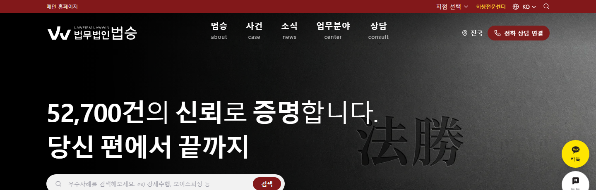
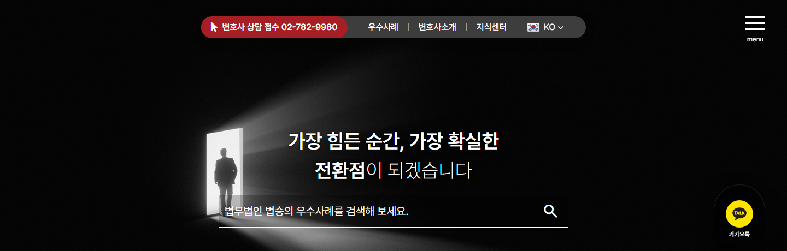
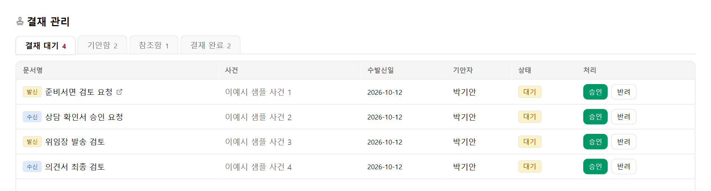
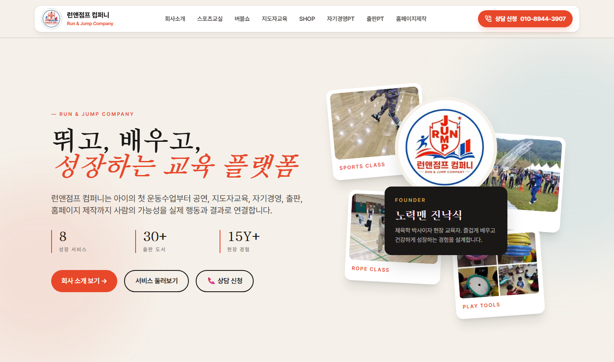
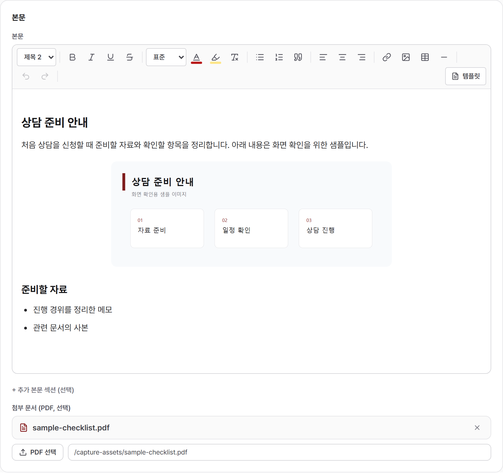
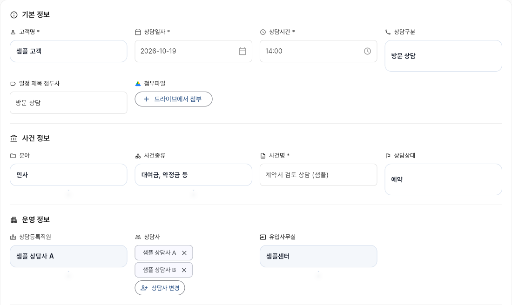

# 진솔 | Software Engineer

## 검색 품질과 데이터 접근을 검증하는 개발자

TypeScript와 Python으로 검색·랭킹, 데이터 연동, 비동기 백엔드를 구현하고 운영했습니다. 검색 근거를 골든셋으로 평가하고, 데이터 접근 경로와 이벤트 전달을 분석했습니다. 구현한 기능을 실제 서비스에 연결한 뒤 응답·로그·정합성을 확인하고 운영 구조를 고쳤습니다.

이 포트폴리오는 법무법인 법승에서 직접 구현한 검색·백엔드·운영 사례를 중심으로 구성했습니다. 회사 소스와 고객 데이터는 비공개이며, 담당 범위와 판단 과정만 설명합니다.

### 프로젝트 구성과 본인 역할

| 프로젝트 | 기간·구성 | 담당 범위·현재 상태 |
|---|---|---|
| 홈페이지 V2와 AI 상담봇 | 홈페이지 2026.05–현재 / 1인 개발 | Next.js·NestJS·Prisma·PostgreSQL 기반 홈페이지와 CMS 구축. RAG 검색·평가·모델 연동 구현. 상담봇은 직원 대상 시범 운영 |
| 사건관리 앱 | 2026.06–현재 / 2인 팀 | 상담·문서·결재·정산 업무 로직과 화면, 담당 조회의 성능 개선, 감사로그·SSE, 배포 운영. 지사 베타 운영 |
| 사내 CRM | 2026.01–현재 / 1인 개발 | Express·Flutter 기반 고객·상담 관리, DB 이관, 외부 API 연동과 동시성 제어. 사내 운영 |

### 기술 경험

**직접 구현:** TypeScript·NestJS·Express, Python·FastAPI·SQLAlchemy, PostgreSQL·pgvector, Docker, Cloud Run·Cloud SQL·Cloud Build.

**이전 경력:** 리얼타임테크에서 Node.js·FFmpeg·Ubuntu 기반 CCTV 서비스 유지보수와 Spring·PostgreSQL 기반 센서 데이터 처리 로직 수정을 수행했습니다. Go는 KOGAS 기존 시스템의 API·인증·실시간 전달 구조 분석에 활용했습니다.

<!-- page-break -->

## 공개 사이트와 담당 범위

### 홈페이지 V2 | 신규 구축

사이트: https://bslawwin.co.kr

Next.js·NestJS·Prisma·PostgreSQL로 공개 홈페이지와 운영 CMS를 구축하고, 콘텐츠·상담 API·데이터 이관·배포를 담당했습니다. **운영 환경은 GCP Cloud Run·Cloud SQL(PostgreSQL)·GCS·Cloud Build**입니다. RAG 상담봇은 이 프로젝트의 내부 모듈로 직원 대상 시범 운영 중입니다.

### 기존 홈페이지 | 유지보수

사이트: https://lawwin.co.kr

**운영 환경은 가비아 Windows Server·IIS·SQL Server**입니다. 기존 ASP.NET 홈페이지의 화면·백엔드 수정, IIS 오류 분석, DNS 전환·롤백, 신규 사이트와의 데이터 동기화를 담당했습니다. 기존 사이트의 유지보수 범위로 구분합니다.

공개 사이트 캡처: 2026.10.14. 검색·데이터 처리와 운영 설계는 앞선 기술 사례에 정리했습니다.

<!-- page-break -->

## 01. RAG 검색과 답변을 따로 평가하기

**홈페이지 V2 내부 모듈 / 검색·평가·생성·출력 검사 구현 / 직원 대상 시범 운영**

### 문제

공개 법률 사례를 근거로 상담 질문에 답하려면 관련 문서를 먼저 찾아야 했습니다. 의미 검색은 동의어에 유리하지만 사건번호와 법조문에 약했고, 글자 검색은 반대였습니다. 검색이 잘되는 것만으로 모델 답변의 신뢰도를 설명할 수도 없었습니다.

### 분석과 판단

화면을 만들기 전에 검색과 평가 도구를 분리했습니다. 개인정보를 제거한 실제 상담 표현과 보완 질문으로 골든셋 50문항을 구성하고, 답변을 하지 않아야 하는 질문도 포함했습니다. 작은 표본에서 정한 유사도 기준을 전체 골든셋으로 다시 확인하자 정답과 무관 질문의 분포가 겹쳐 기준을 조정했습니다.

### 구현

공개 글 4,398건을 7,786조각으로 청킹·임베딩해 pgvector에 적재하고, 의미 검색과 글자 검색의 순위를 RRF로 결합했습니다. 법률 용어가 코퍼스에서 흔하므로 단어 빈도만으로 잡음을 제거하는 방법은 맞지 않았습니다. 의미 검색이 근거를 찾지 못한 질문은 글자 검색만으로 통과시키지 않는 게이트를 적용했습니다. 조회 때 원문 공개 여부를 확인하고, 변경 없는 조각은 다시 임베딩하지 않도록 했습니다.

검색 근거를 Vertex AI의 Gemini에 전달하고 SSE로 답변을 전송했습니다. 금지 표현은 전송 전 누적문으로 검사하고, URL·연락처는 응답 완료 후 허용 목록과 대조했습니다. 연락처는 모델 생성에 맡기지 않고 검증된 데이터로 붙였습니다. 실제 오류 표현은 회귀 테스트에 남겼습니다.

### 검증과 한계

골든셋 기준 **Recall@5 95.8%**를 기록했습니다. 검색 결과의 근거 회수율을 측정하고, 생성 답변의 오류와 무관 질문 대응은 별도로 점검했습니다. 현재 직원 대상 시범 운영으로 적용 범위를 제한해 검증하고 있습니다.

### 생성 기능을 서비스 운영에 연결한 사례

별도 사례 요약·FAQ 모듈에서는 생성 결과를 원문과 분리 저장하고, 원문 대조 검사·비공개 분류를 연결해 3,038건을 공개했습니다. 원문 변경 시 재생성과 재검사까지 이어지도록 구현했습니다.

<!-- page-break -->

## 02. 원격 데이터의 위치까지 추적한 조회 최적화

**사건관리 앱 / 2인 팀 중 담당 상담료 조회의 CRUD·SQL 수정 / 지사 베타 운영**

### 문제

상담료 처리 대기 목록을 여는 데 8초가 걸렸습니다. 해당 목록은 사건관리 DB의 스케줄과 CRM의 이름·사무소 정보를 조합하고 있었습니다. SQL에서 테이블처럼 보이는 CRM 데이터가 실제로 어디에 있는지부터 확인해야 했습니다.

### 분석과 판단

FastAPI·SQLAlchemy의 CRUD 코드와 SQL 조회 경로를 추적해 CRM 스키마가 `postgres_fdw`로 연결된 원격 테이블임을 확인했습니다. 해당 인라인 조인은 원격으로 전달되지 않아 많은 데이터를 가져온 뒤 로컬에서 다시 거르고 있었습니다. 인덱스 조정보다 조회 구조를 바꿔 불필요한 원격 데이터 접근을 줄이는 것이 먼저라고 판단했습니다.

### 구현

스케줄을 먼저 조회해 필요한 대상을 정하고, 그 대상의 이름·사무소 정보를 묶어 조회하도록 Python CRUD와 SQL을 수정했습니다. 필요한 정보는 애플리케이션에서 결합해 원격 테이블과의 인라인 조인을 제거했습니다.

별도의 사건목록 병목에서는 조인 키의 `text`와 `character(8)` 타입 불일치 때문에 기존 인덱스가 쓰이지 않는 것을 확인했습니다. 명시적 형 변환으로 인덱스 사용 경로를 복원했습니다. 비슷한 지연 증상도 데이터 위치와 타입에 따라 원인을 나누었습니다.

### 검증과 한계

담당 상담료 조회는 **8초 → 0.05초**, 타입 불일치를 수정한 사건목록 조회는 **1,695ms → 109ms**로 개선됐습니다. 측정 범위는 각각 해당 조회의 개선 전후 응답시간입니다. 2인 팀에서 제가 수정한 CRUD·SQL 경로의 개선 결과입니다.

<!-- page-break -->

## 03. 확정된 변경을 실시간으로 전달하기

**사건관리 앱의 감사로그·SSE와 CRM 동시성 제어 / 담당 기능 구현**

### 문제

폴링으로 갱신하던 업무 화면은 변경 반영이 늦었습니다. API마다 감사로그와 이벤트 코드를 추가하면 새 기능에서 누락될 위험이 있었습니다. 여러 사용자와 인스턴스가 동시에 움직이는 환경에서는 변경 전달뿐 아니라 중복 실행과 업무 충돌도 다뤄야 했습니다.

### 분석과 판단

업무 데이터가 롤백됐는데 감사로그나 알림만 남으면 잘못된 변경을 전달하게 됩니다. ORM 변경을 공통 지점에서 수집하고, 감사로그 저장과 이벤트 발행의 시점을 구분했습니다. 별도 브로커 대신 이미 쓰던 PostgreSQL의 `LISTEN/NOTIFY`를 선택했습니다.

### 구현

SQLAlchemy 세션 훅에서 변경 차이를 수집하고, 업무 데이터와 감사로그를 같은 트랜잭션에 저장했습니다. 커밋 후 확정된 변경을 발행했습니다. 별도 스레드의 LISTEN 수신을 이벤트 루프로 전달하고 접속자별 asyncio 큐에서 SSE로 전송했습니다. 브라우저는 `fetch`·`ReadableStream`으로 인증 헤더를 전달하고, 관련 쿼리 캐시를 갱신하도록 했습니다.

CRM의 MySQL 운영 시기에 `GET_LOCK`을 사용해 다중 인스턴스의 동기화 스케줄러 중복 실행을 제어했습니다. 동일 접수에는 점유 상태·수정 제한·만료 회수를 구현해 다른 직원이 이어받을 수 있게 했습니다. Named Lock은 PostgreSQL 이관 전 적용한 구현입니다.

### 검증과 한계

운영에서 SSE를 막던 압축 미들웨어와 CDN 버퍼링을 로그·배포 경로별로 확인하고, SSE 압축 예외와 Cloud Run 직접 연결로 수정했습니다. 이벤트는 변경 신호이며 화면은 최신 데이터를 다시 조회합니다. RAG 답변 스트리밍과 구분되는 업무 변경 전파 기능입니다.

위 화면은 실제 React 소스를 합성 데이터·인증·API 응답으로 로컬 실행한 캡처입니다(2026.10.12). 담당 화면을 보여주며, SSE·감사로그의 검증 내용은 본문의 구현·운영 기록에 근거합니다.

<!-- page-break -->

## 04. 배포 완료 뒤 실제 API 응답까지 확인하기

**사건관리 앱 배포 장애 복구와 절차 개선 / 이후 신규 시스템에 적용**

### 문제

Cloud Run 소스 기반 배포에서 의도한 백엔드 이미지 대신 프런트엔드 정적 서빙 이미지가 배포됐습니다. 배포 작업은 완료됐지만 API가 JSON 대신 HTML을 반환해 서비스가 정상 동작하지 않았습니다.

### 분석과 판단

응답 본문과 이미지 빌드 경로를 확인해 잘못된 Dockerfile 선택을 원인으로 좁혔습니다. 우선 이전 리비전으로 롤백하고, 컨테이너가 기동했다는 사실과 의도한 애플리케이션이 응답한다는 사실을 별도로 검증해야 한다고 판단했습니다.

### 구현

루트 Dockerfile을 명시해 이미지를 빌드하고, 생성된 이미지를 지정해 배포하도록 절차를 분리했습니다. 배포 후 API 응답 본문과 `Content-Type`을 함께 확인하도록 정리했습니다. 같은 절차를 신규 사내 포털에도 적용했습니다. 운영 예열은 Cloud Scheduler와 서비스 단위 설정으로 관리했습니다.

### 검증과 한계

이전 리비전 복구와 실제 API 응답으로 정상 서비스를 확인했습니다. 복구 뒤에도 이미지와 응답을 확인하는 절차를 남겨 이후 배포에 적용했습니다. 검증 범위는 이미지 선택과 해당 API의 실제 응답입니다.

### 데이터 이관과 지속 동기화

레거시 SQL Server의 730만 건을 PostgreSQL로 이관했습니다. 운영 중에는 레거시가 변경 데이터를 신규 백엔드 HTTPS API로 전달하고, 원본 키·접수 고유키로 대조해 재실행 중복을 제한했습니다. 누락 데이터를 복구하고 실패 알림과 별도로 실행 기록이 없는 구간을 감시했습니다.

### 이전 시스템에서 쌓은 분석·유지보수 경험

리얼타임테크의 ETRI CCTV 서비스에서는 Node.js 유지보수, Windows·Ubuntu별 FFmpeg 처리 분기, Ubuntu 스크립트 실행·배포를 담당했습니다. 환경 차이를 코드와 실행 경로에서 확인했습니다.

KOGAS에서는 신규 개발의 근거자료를 만들기 위해 Go 기반 기존 시스템을 분석했습니다. REST API·JWT 인증·Gorilla WebSocket의 설비별 브로드캐스트와 논블로킹 전송, Docker·systemd 배포 구조를 정리했습니다. 담당 범위는 기존 코드 분석과 신규 설계의 근거자료 정리입니다.

<!-- page-break -->

## 공개 코드와 업무 화면

### 런앤점프 컴퍼니 | Next.js 기업 홈페이지

코드: https://github.com/sorrybro2/runandjump-company  
사이트: https://runandjump-five.vercel.app

회사소개와 사업별 콘텐츠 페이지를 구성하고, 회사정보·메뉴 데이터를 공통화했습니다. TypeScript로 탭·콘텐츠 블록의 입력 타입을 정의해 페이지에서 재사용하고, 모바일 메뉴·카드 배치를 조정했습니다.

GSAP·Lenis 스크롤 효과는 모션 감소 설정을 따르고, 컴포넌트 해제 시 ticker·스크롤 인스턴스와 IntersectionObserver를 정리하도록 구현했습니다. 공개 코드를 통해 공통화·타입 정의·이벤트 생명주기 처리를 확인할 수 있습니다.

### 사내 업무 화면 | 샘플 데이터로 실행

<figure><figcaption>홈페이지 V2의 CMS 편집 화면. 실제 Next.js 컴포넌트에 샘플 글·이미지·PDF와 업로드 응답을 넣어 실행했습니다.</figcaption></figure>
<figure><figcaption>단독 구축한 CRM의 상담 입력 화면. 실제 Flutter 폼을 합성 고객·직원·일정 데이터로 실행했습니다.</figcaption></figure>

런앤점프는 2026.10.14 공개 사이트 캡처이며, 사내 화면은 2026.10.12 로컬 실행 자료입니다. 사내 캡처는 화면·입력 구조를 보여주는 자료로, 운영 DB 저장이나 외부 연동 성공과 구분합니다.
